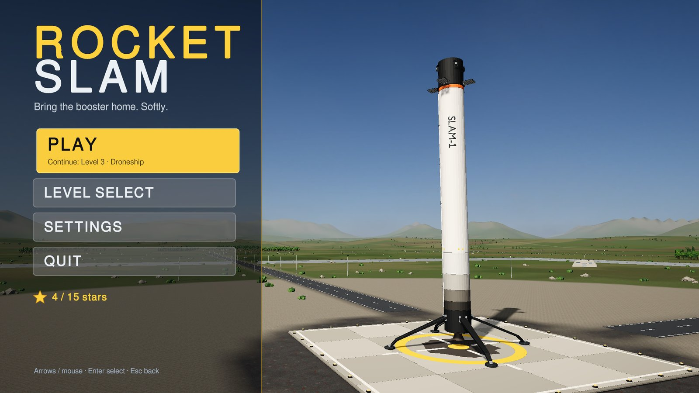
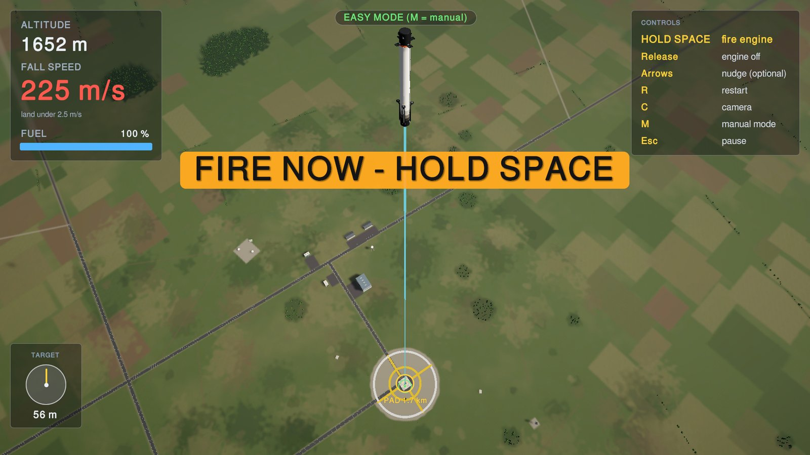
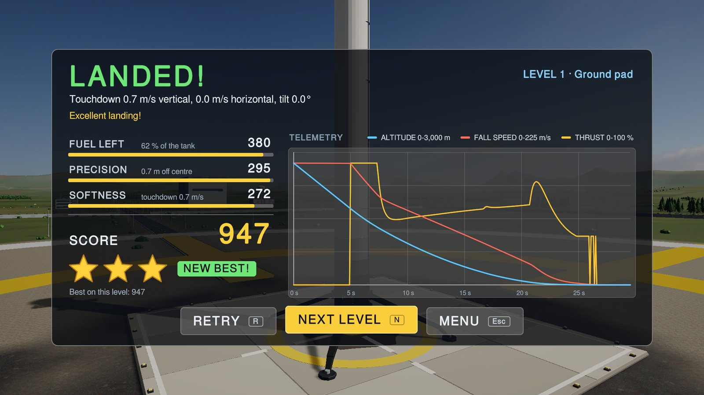
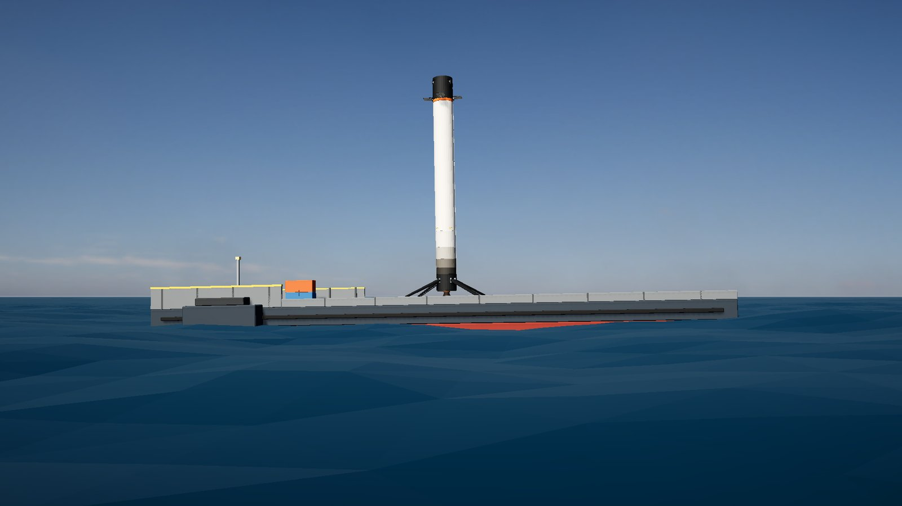
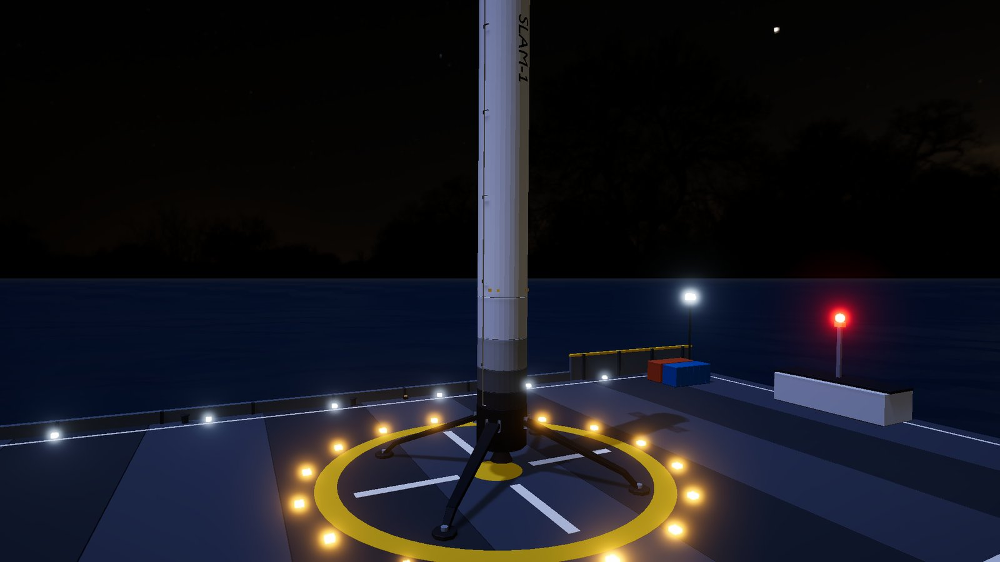
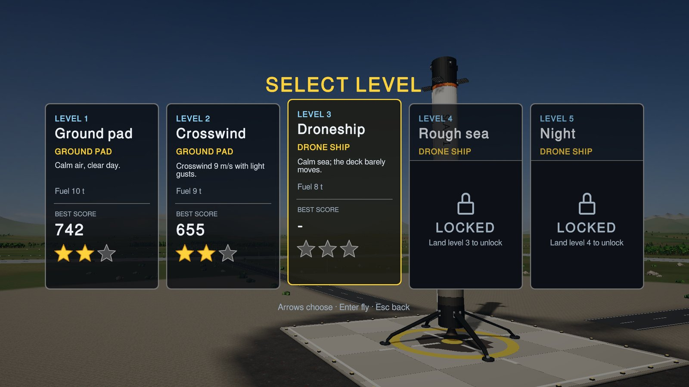

# Rocket Slam

**Bring the booster home. Softly.**

A 3D game about landing a reusable rocket booster. The first stage falls back from 3 km at
around 200 m/s; light the engine at the last possible moment (the "hoverslam"), steer onto the pad and
touch down under 2.5 m/s, on a ground pad or on a pitching drone ship at sea, by day and by night.
Burn too early and the tank runs dry; burn too late and it is a very expensive fireball.

Own design: the booster "SLAM-1", the pad and the drone ship are original low-poly models; no real
rocket company, vehicle or logo appears in the game.



| | |
|---|---|
|  |  |
|  |  |
|  | |

## How to play

Two control modes; switch any time with **M** (gamepad **X**), choose the default in Settings.

**Easy** (default): the rocket steers itself to the pad and lowers its legs. You only fire the engine:
wait for **FIRE NOW**, then **hold Space** (gamepad **A** or **right trigger**). The engine can only
slow you down, never push you back up, and the last metres are guided to a soft touchdown.

**Manual**: you fly everything yourself, with real limits (the engine throttles only down to 40 %).

| Action | Keyboard | Gamepad |
|---|---|---|
| Engine on / off | Space | A |
| Throttle up / down | Shift / Ctrl (mouse wheel ±10 %) | Right / left trigger |
| Full / minimum throttle | Z / X | RB / LB |
| Steer (camera-relative) | WASD or arrows | Left stick |
| Landing legs | G | Y |
| Camera (chase, engine, pad side) | C | Right stick click |
| Easy / Manual mode | M | X |
| Restart | R | Select / View |
| Pause | Esc | Start |

Menus work with arrows + Enter + Esc, the mouse, or the d-pad / left stick + A + B. In the pause
menu, Start or B resumes. On-screen hints switch to gamepad buttons when you use a gamepad.

A landing counts when all four feet are on the pad (or deck) and the stage touches down with at most
**2.5 m/s** vertical speed, **1.5 m/s** sideways and **6°** tilt, then stays upright for 3 seconds.
Speeds at sea are measured relative to the moving deck.

## Levels

| # | Level | Conditions | Fuel |
|---|---|---|---|
| 1 | Ground pad | Calm air, clear day | 10 t |
| 2 | Crosswind | Steady 9 m/s crosswind with gusts | 9 t |
| 3 | Droneship | Calm sea, the deck barely moves | 8 t |
| 4 | Rough sea | Waves heave, pitch and roll the deck; gusty wind | 7 t |
| 5 | Night | Night, fog and strong gusts; follow the deck lights | 6 t |

Landing a level unlocks the next one. Progress, best scores and settings are saved locally
(`rocketslam_save.json` in Unity's persistent data folder).

## Scoring

Each landing scores up to **1000 points**:

| Part | Points | Full marks for |
|---|---|---|
| Fuel | 400 | 65 % of the tank left (linear below) |
| Precision | 300 | within 0.5 m of the target centre (0 at 12 m) |
| Softness | 300 | touchdown at 0.5 m/s, no sideways speed |

**Stars:** ★ = landed, ★★ and ★★★ = the level's score thresholds (L1 650 / 795 down to L5 560 / 700).
Calibrated with test bots: a first-time Easy landing earns two stars, a well-timed late burn three.
The results screen shows the breakdown and a graph of altitude, fall speed and thrust over the flight.

## Build and run

Requirements: Unity Hub with Unity **6000.6.9f1** (Linux and Windows Mono build support), Blender 5.x
on `PATH` (only to regenerate models), Python 3. Open `unity/` in Unity Hub to work in the editor.

```bash
UNITY=~/Unity/Hub/Editor/6000.6.9f1/Editor/Unity

# import + compile
$UNITY -batchmode -nographics -projectPath unity -quit -logFile unity/Logs/batch.log

# tests (EditMode headless; PlayMode needs graphics)
$UNITY -batchmode -nographics -projectPath unity -runTests -testPlatform EditMode -testResults Logs/editmode.xml -logFile unity/Logs/tests.log
$UNITY -batchmode -projectPath unity -runTests -testPlatform PlayMode -testResults Logs/playmode.xml -logFile unity/Logs/tests.log

# rebuild all scenes from code + Linux player -> builds/Linux/RocketSlam.x86_64
$UNITY -batchmode -projectPath unity -executeMethod BuildScript.BuildScenesAndLinux -quit -logFile unity/Logs/build.log
# Windows player -> builds/Windows/RocketSlam.exe
$UNITY -batchmode -projectPath unity -executeMethod BuildScript.BuildWindows -quit -logFile unity/Logs/build_win.log

# regenerate a model (headless Blender)
blender -b --factory-startup --python blender/scripts/booster.py
```

`tools/unity/full.sh play` does the scene rebuild, Linux build and both test suites in one go;
`tools/unity/bench.sh 1 4 5` benchmarks levels at 1920×1080.

Player options: `-level N` starts a level directly, `-save <file>` uses another save file,
`-benchmark <file>` flies an Easy bot and writes frame-time statistics, `-autocapture <dir>` (with
`-autocapture-easy` or `-autocapture-crash`) and `-autocapture-m5 <dir>` take automated screenshots.

## Releases

`tools/release.sh` packages both players and publishes them as a GitHub Release:

```bash
export GITHUB_TOKEN=...          # fine-grained token, this repo, "Contents: Read and write"
tools/release.sh                 # first release v1.0.0, then v1.0.1, v1.0.2, ...
tools/release.sh 1.1.0 --build   # explicit version, rebuild both players with Unity first
tools/release.sh --dry-run       # only build the zips in builds/release/ and show the notes
```

It zips `builds/Linux` and `builds/Windows` (without Unity's debug side folders), tags `vX.Y.Z`,
pushes the tag, creates the release and uploads the zips with SHA-256 sums in the notes.
The working tree must be clean and pushed.

## Project layout

| Path | What |
|---|---|
| [`unity/`](unity/) | Unity project (URP). Game code in `Assets/Scripts/` (rocket physics, Easy assist, landing rules, levels, sea and wind, effects, sound, HUD and menus), editor scripts in `Assets/Editor/` that build every scene, material, effect and quality preset from code, tests in `Assets/Tests/`. |
| [`blender/`](blender/) | Blender Python generators (`scripts/`) for the booster, pad, drone ship, scenery and the palette texture; they export FBX into `unity/Assets/Models/` and render previews to `renders/`. |
| [`tools/`](tools/) | Asset download (`fetch_assets.py`) and build / test / benchmark wrappers (`unity/`). |
| [`docs/`](docs/) | README screenshots. |
| [`THIRD_PARTY.md`](THIRD_PARTY.md) | Every third-party asset with source and licence. |

## How it was made

Rocket Slam was built almost entirely by Claude (Anthropic's AI model) in Claude Code, as a showcase of
what an AI agent can build end to end, from a written spec ([PLAN.md](PLAN.md), in Czech) in six milestones.

- **Orchestrator + subagents.** A main session planned each milestone and delegated the work to
  subagents with fixed roles: an *implementer* (C#, UI Toolkit, scenes, tests, builds), a *modeler*
  (Blender scripts), an *asset scout* (CC0 assets) and a fresh *reviewer* at the end of every milestone.
- **Everything from code.** Scenes, materials, particle effects and quality presets are generated by
  editor scripts; every 3D model comes from a Blender Python generator (1 unit = 1 m); nothing is
  hand-edited.
- **Verified, not guessed.** EditMode and PlayMode tests (physics, landing rules, scoring, saves,
  bots that fly every level with keyboard and gamepad), automated screenshots that were looked at,
  and frame-time benchmarks on the target laptop (integrated Radeon GPU, 60 FPS at 1080p).
- **CC0 assets only** from kenney.nl (sounds, particle sprites), polyhaven.com (sky HDRIs) and
  ambientcg.com (ground textures), listed in [THIRD_PARTY.md](THIRD_PARTY.md).

## Licence

Code and generated content: [MIT](LICENSE). Third-party assets: CC0 (public domain), see
[THIRD_PARTY.md](THIRD_PARTY.md).
